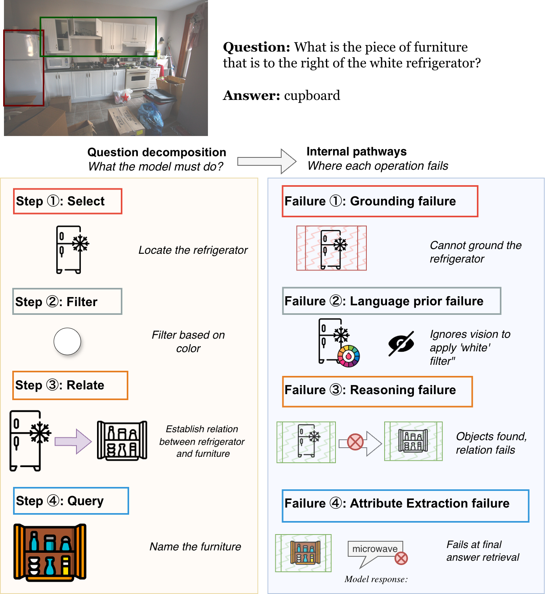
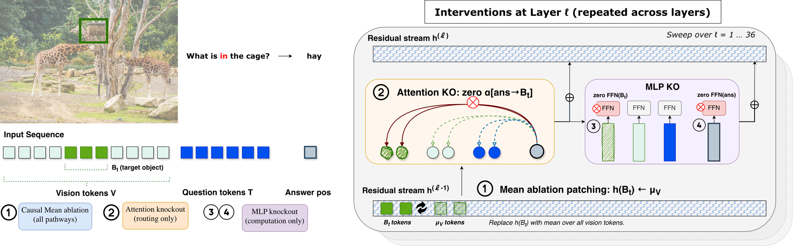

# How Do VLMs Fail? Vision-Operation Misalignment in Compositional VQA

**Accepted at ACM Multimedia 2026** · [Paper (arXiv)](https://arxiv.org/pdf/2607.16094)

Code and data for the paper. We split each GQA question into its reasoning steps (select,
relate, query, …) and find the image tokens of the objects each step needs. Then, one layer
at a time, we cut the model off from those tokens and measure how much its answer suffers.
This shows where a failure starts and whether it runs through attention or the MLPs.

<p align="center">
  
</p>

## Files

<p align="center">
  
</p>

| File | What it does |
|---|---|
| `causal_mean_ablation.py` | ① Replaces an object's image tokens with the average image token, one layer at a time. |
| `attn_knockout.py` | ② Stops the answer from attending to an object's image tokens, one layer at a time. |
| `mlp_knockout.py` | ③④ Replaces the MLP output at the object's tokens (③) or at the answer (④) with an average. |
| `probing_abl.py` | Trains per-layer probes that tell a question apart from a slightly edited version. |
| `llava_causal_mean_ablation.py`, `llava_attn_knockout.py`, `llava_mlp_knockout.py` | The same three experiments for LLaVA-1.5. |
| `HookedQwenVL.py`, `HookedLLaVA.py` | Load each model and add the hooks the experiments use. |
| `bbox_utils.py`, `qwen_vl_patch_utils.py` | Find which of Qwen's image tokens cover an object's box. |
| `data/GQA_3500.json` | 3,500 GQA questions (500 per operation) with their programs and object boxes. |
| `data/probing_operations.json` | 1,200 questions, each paired with an edited version that has a different answer. |
| `requirements.txt` | Package versions we tested with. |

The scripts without a `llava_` prefix run Qwen2.5-VL-3B, the paper's main model.

## Setup

```bash
git clone https://github.com/navyg18/how-do-vlms-fail.git && cd how-do-vlms-fail
python3.11 -m venv .venv && source .venv/bin/activate
pip install -r requirements.txt

# GQA images (20 GB); the JSON files point to them
wget https://downloads.cs.stanford.edu/nlp/data/gqa/images.zip
unzip -q images.zip -d data/      # creates data/images/
```

Model weights download from Hugging Face on first use.

**GPU:** one GPU with 16 GB runs every script. Only `attn_knockout.py --head_level` (an extra
per-head scan) needs about 48 GB. Measured on one NVIDIA H200:


## Quick test (a few minutes)

Run from the repo folder:

```bash
python attn_knockout.py       --samples data/GQA_3500.json --max_per_op 1
python llava_attn_knockout.py --samples data/GQA_3500.json --max_per_op 1
```

`--max_per_op 1` uses one question per operation. If you see `image files not found`, check
that you are in the repo folder and that `data/images/` exists.

## Reproduce the paper

**1. Run the experiments.** Each line is independent; add `--device cuda:1` and so on to run
them side by side on several GPUs.

```bash
python causal_mean_ablation.py --samples data/GQA_3500.json            # Table 3: Acc. and Mean Ablation
python attn_knockout.py        --samples data/GQA_3500.json            # Table 3: Attn KO; Figure 4
python mlp_knockout.py         --samples data/GQA_3500.json            # Table 3: MLP KO
python probing_abl.py          --samples data/probing_operations.json  # Table 2

python llava_causal_mean_ablation.py --samples data/GQA_3500.json      # LLaVA-1.5 results
python llava_attn_knockout.py        --samples data/GQA_3500.json
python llava_mlp_knockout.py         --samples data/GQA_3500.json
```

**2. Compare with the paper.** Each script ends by printing one row per operation:

| Script | Printed columns | Paper |
|---|---|---|
| `causal_mean_ablation.py` | `pv_c`, `pv_i`, `cohen_d` | Table 3, Mean Ablation: GS✓, GS×, 𝑑 |
| `attn_knockout.py` | `KO_c`, `KO_i`, `cohen_d` | Table 3, Attn KO: KO✓, KO×, 𝑑 |
| `mlp_knockout.py` | `peak_c`, `peak_i`, `cohen_d` under "answer MLP KO" | Table 3, MLP KO: KO✓, KO×, 𝑑 |
| `probing_abl.py` | `VS`, `NV`, `VS-NV` | Table 2 |

Table 3's accuracy column is the share of `"model_correct": true` per operation in
`results/causal_mean_ablation/per_sample_results.jsonl`. Every script also saves its
per-question curves to `results/<script name>/`; Figures 3 and 4 plot these.

**Notes**

- Keep the default settings. They match the runs behind the paper, which is why the scripts
  differ in small ways, such as number precision and an "Answer with yes or no." hint that only
  the LLaVA scripts add. Comments in the code mark each one.
- In Table 3, the Attn KO values for choose and filter come from a separate run at a different
  precision. `attn_knockout.py` reports all seven operations at the precision of the other five rows.
- We checked the mean-ablation, attention and MLP scripts against our original runs,
  question by question: the results are identical (LLaVA mean ablation within 0.06).

## Use your own data

Put your images in a folder and write a JSON file in this format:

```json
{
  "images": {
    "2316017": {
      "image_path": "2316017.jpg",
      "objects": {
        "3792992": {"name": "table",  "bbox": [103, 121, 105, 116]},
        "1538065": {"name": "candle", "bbox": [140, 90, 20, 45]}
      },
      "samples": [
        {
          "question_id": "q1",
          "question_clean": "What's on the table?",
          "answer": "candle",
          "operation": "relate",
          "semantic_program": [
            {"operation": "select", "dependencies": [],  "argument": "table (3792992)"},
            {"operation": "relate", "dependencies": [0], "argument": "_,on,s (1538065)"},
            {"operation": "query",  "dependencies": [1], "argument": "name"}
          ]
        }
      ]
    }
  }
}
```

Then run any script with `--samples my_data.json --image_dir my_images/`.

- `bbox` is `[x, y, width, height]` in pixels of the original image.
- A program step names its object by id: `"table (3792992)"` points to `objects["3792992"]`.
- `operation` decides which objects are cut off:
  - `select`: every selected object
  - `query`, `filter`, `choose`: the first selected object
  - `relate`: the object found by the last `relate` step
  - `verify`: the first selected object and the object in the `verify` step
  - `exist`: each selected object that feeds an `exist` step
- No program? Use `"operation": "select"` with one step naming the object the answer depends on:
  `[{"operation": "select", "dependencies": [], "argument": "cup (1)"}]`.
- For probing, also add `question_corrupted`: the question with one detail changed so the
  answer changes.
- Short answers (one or two words) work best, because the scripts score the answer's
  log-probability.

## Use another model

- **Other Qwen2.5-VL sizes or LLaVA-1.5 checkpoints:** pass `--model_id`, for example
  `Qwen/Qwen2.5-VL-7B-Instruct` or `llava-hf/llava-1.5-13b-hf`. Layer and head counts are read
  from the model.
- **A new architecture:** copy the LLaVA files and change `build_inputs` (the prompt),
  `get_vision_indices` (where the image tokens are) and `bbox_to_token_positions` (which tokens
  cover a box). The attention knockout also needs `attn_implementation="eager"`.

## Citation

```bibtex
@article{gupta2026vlms,
  title={How Do VLMs Fail? Vision-Operation Misalignment in Compositional VQA},
  author={Gupta, Navya and Xu, Bingjie and Anand, Avinash and Liu, Timothy and Zhang, Zhengchen},
  journal={arXiv preprint arXiv:2607.16094},
  year={2026}
}
```

The images, questions, programs and scene graphs in `data/` come from
[GQA](https://cs.stanford.edu/people/dorarad/gqa/) (Hudson & Manning, CVPR 2019), whose images
come from [Visual Genome](https://homes.cs.washington.edu/~ranjay/visualgenome/). Please follow
their terms of use.
